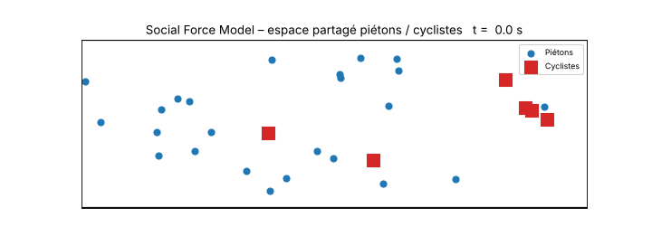
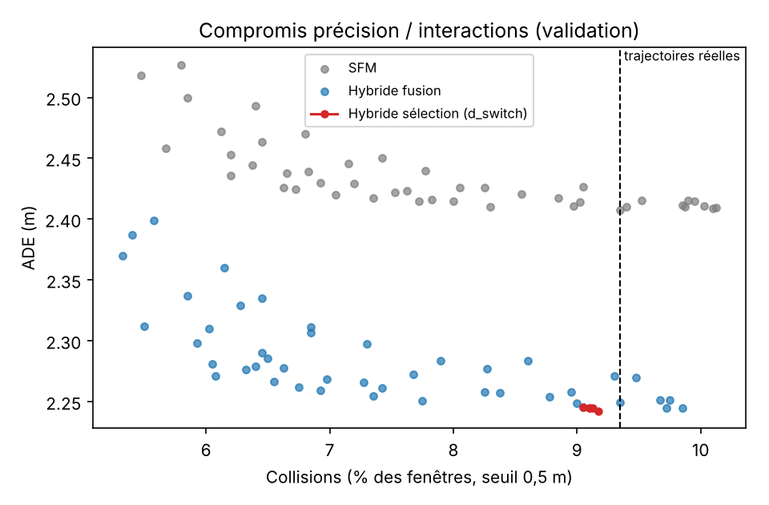
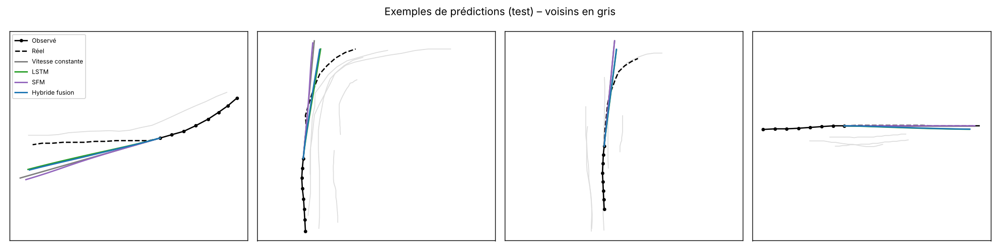

# Simulation hybride des trajectoires de cyclistes : Social Force Model + Deep Learning

Ce projet compare deux familles de modèles pour prédire le déplacement de cyclistes dans des espaces partagés (piétons, cyclistes, véhicules), puis teste deux façons de les combiner :

- un **modèle comportemental** : le Social Force Model (SFM, Helbing & Molnár, 1995), interprétable, qui gère explicitement l'évitement des autres usagers ;
- un **modèle appris** : un LSTM encodeur-décodeur entraîné sur des trajectoires réelles de cyclistes filmées par drone (Stanford Drone Dataset) ;
- deux **stratégies hybrides** : *fusion* (le LSTM donne l'intention, le SFM gère les interactions) et *sélection* (le SFM n'est activé qu'en situation de proximité).



*Simulation SFM (`scripts/simulate_sfm.py`) : 24 piétons (~1,3 m/s) et 6 cyclistes (~4 m/s, rayon plus grand) dans une allée de 30 m x 10 m.*

## Résultats

Prédiction de 12 positions (4,8 s) à partir de 8 positions observées (3,2 s), sur **5 958 fenêtres de test** issues de 12 vidéos jamais vues à l'entraînement.

| Méthode | ADE (m) ↓ | FDE (m) ↓ | Collisions (%) | Accél. > 4 m/s² (%) |
| --- | --- | --- | --- | --- |
| Trajectoires réelles (référence) | – | – | 1,33 | 26,9 |
| Vitesse constante | 2,247 | 5,062 | 2,15 | 0,0 |
| Social Force Model | 2,245 | 5,059 | 2,08 | 0,1 |
| LSTM encodeur-décodeur | 2,129 | 4,808 | 2,08 | 0,3 |
| **Hybride fusion (LSTM + SFM)** | **2,122** | **4,795** | 2,06 | 0,3 |
| Hybride sélection | 2,129 | 4,807 | **2,01** | 0,3 |

- **ADE / FDE** : erreur moyenne / finale de position, en mètres.
- **Collisions** : part des fenêtres où la trajectoire prédite passe à moins de 0,5 m d'un usager réel au même instant.
- **Accél. > 4 m/s²** : part des prédictions avec une accélération irréaliste. Les annotations réelles dépassent souvent ce seuil à cause du bruit des boîtes englobantes : ce critère sert surtout à vérifier que les modèles restent physiquement lisses.



### Ce qu'on retient

1. **Le LSTM bat la vitesse constante** : −5,3 % d'ADE et −5,0 % de FDE. Le gain reste modeste, car sur 4,8 s la baseline à vitesse constante est réputée difficile à battre.
2. **Le SFM seul n'améliore pas la précision**, mais il réduit les collisions. Sur la validation (scènes plus denses : 5,6 voisins à moins de 10 m en moyenne, contre 2,2 en test), on voit un vrai **compromis précision / sécurité** (figure ci-dessus) : avec une répulsion forte (A = 2, B = 0,3), la fusion hybride fait passer les collisions de 10,6 % à 7,0 %, pour seulement +0,03 m d'ADE.
3. **La fusion hybride donne la meilleure précision du test**, avec un écart faible par rapport au LSTM (−0,007 m). Les paramètres ont été choisis **sur la validation, avec une règle fixée avant l'évaluation** : le plus petit ADE parmi les réglages qui ne produisent pas plus de collisions que les trajectoires réelles. Cette règle retient une répulsion faible (A = 0,5, B = 0,2, τ = 0,3 s), ce qui explique l'effet limité en test.
4. **Les modèles déterministes ne savent pas anticiper un virage** qui n'est pas amorcé dans l'historique (figure ci-dessous). C'est la principale source d'erreur, et une motivation pour les modèles multimodaux (par exemple la diffusion).



### Limites

- **Données** : SDD, et non le jeu CTV. Les positions sont les centres de boîtes englobantes, donc bruitées, et 6 vidéos sans échelle pixel → mètre sont exclues.
- **Voisins** : leur futur est extrapolé à vitesse constante dans le SFM et les hybrides.
- **Paramètres** : un seul jeu de paramètres SFM pour tous les usagers, sans distinction piéton / cycliste / voiture côté voisins.
- **Statistiques** : une seule graine d'entraînement, sans intervalle de confiance.
- **Métrique de collision** : seuil fixe de 0,5 m entre centres. Les trajectoires réelles elles-mêmes « collisionnent » dans 1,3 à 9,4 % des cas, selon la densité.

### Pistes

- Intégrer le modèle appris dans [SPACiSS](https://github.com/maprdhm/Spaciss), simulateur multi-agents basé sur ROS / pedsim_ros (C++), par exemple via un nœud ROS Python qui fournit la vitesse désirée de chaque cycliste.
- Utiliser le jeu CTV (cyclistes en espace partagé), apprendre les paramètres du SFM par type d'usager, et passer à un modèle de prédiction multimodal.

## Reproduire

```bash
pip install -r requirements.txt

# 1. Données : annotations du SDD depuis le dépôt OpenTraj (environ 425 Mo, sans les vidéos)
git clone --depth 1 --filter=blob:none --no-checkout https://github.com/crowdbotp/OpenTraj
cd OpenTraj && git sparse-checkout init --no-cone
printf '/datasets/SDD/*/*/annotations.txt\n/datasets/SDD/H_SDD.txt\n' > .git/info/sparse-checkout
git checkout && cd ..

# 2. Fenêtres cyclistes (train / val / test séparés par vidéo)
python scripts/prepare_sdd.py --sdd-root OpenTraj/datasets/SDD

# 3. Entraînement du LSTM (~5 min sur CPU)
python scripts/train_lstm.py

# 4. Calibrage sur la validation + évaluation sur le test + figures
python scripts/evaluate.py

# 5. Simulation SFM animée
python scripts/simulate_sfm.py
```

Les poids du LSTM entraîné sont fournis dans `results/lstm_sdd_biker.pt`. Les étapes 2, 4 et 5 suffisent donc à reproduire les tableaux. Un notebook Google Colab est disponible : [`notebooks/colab_reproduce.ipynb`](https://colab.research.google.com/github/yosr-gabsi/cyclist-trajectory-hybrid/blob/main/notebooks/colab_reproduce.ipynb).

## Organisation

```
hybemo/
  data.py      # chargement du SDD, conversion en mètres, fenêtres 8 + 12, voisins, découpage par vidéo
  models.py    # baseline vitesse constante, LSTM encodeur-décodeur, augmentation par rotation
  sfm.py       # Social Force Model vectorisé (simulation et prédiction)
  hybrid.py    # stratégies hybrides : fusion et sélection
  metrics.py   # ADE, FDE, collisions, accélérations
scripts/       # préparation, entraînement, évaluation, simulation
results/       # poids, métriques (JSON) et figures
```

## Références

- D. Helbing, P. Molnár. *Social force model for pedestrian dynamics*. Physical Review E, 1995.
- A. Robicquet et al. *Learning Social Etiquette: Human Trajectory Understanding in Crowded Scenes* (Stanford Drone Dataset). ECCV 2016.
- J. Amirian et al. *OpenTraj: Assessing Prediction Complexity in Human Trajectories Datasets*. ACCV 2020.
- A. Mukbil, Y. Yousif, S. Hossain, J. P. Müller. *CTV-Dataset: A Shared Space Drone Dataset for Cyclist-Road User Interaction Derived from Campus Experiments*. IEEE ITSC 2023.
- M. Prédhumeau, L. Mancheva, J. Dugdale, A. Spalanzani. *Agent-Based Modeling for Predicting Pedestrian Trajectories Around an Autonomous Vehicle*. JAIR, 2022.

## Licence

Code sous licence MIT. Les annotations du Stanford Drone Dataset sont sous licence CC BY-NC-SA 3.0 et ne sont pas redistribuées ici.

---
Auteure : Yosr GABSI, élève-ingénieure en mécatronique, ENICarthage.
